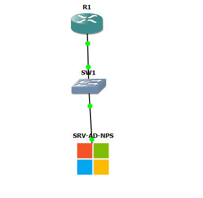
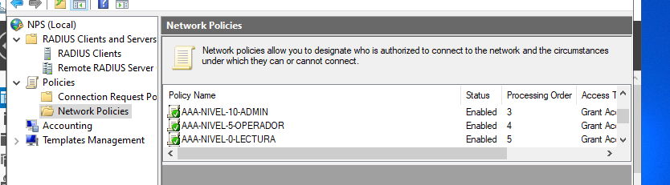
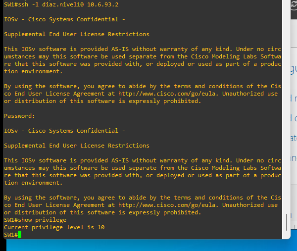
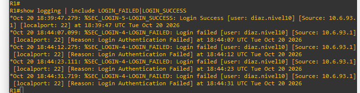
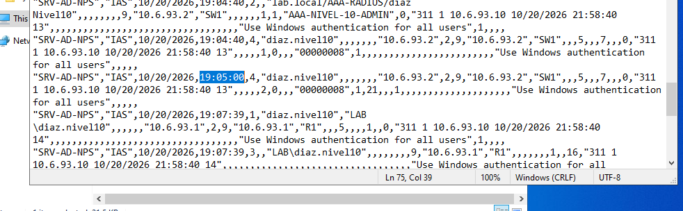
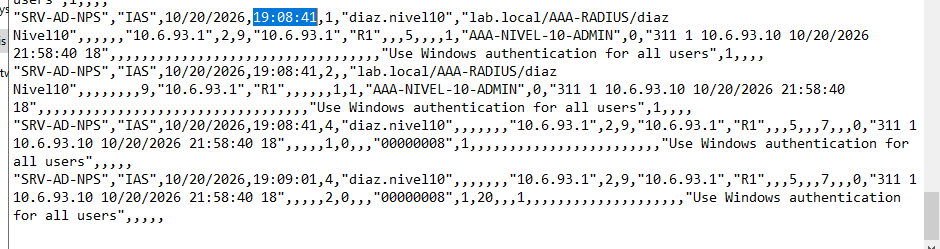

# Semana 6 — Infraestructura AAA/RADIUS con Active Directory, NPS y Cisco
Jose Miguel Diaz - 2025-0693

> **🎬 Video demostrativo (YouTube): [https://youtu.be/5g14_T_egnA](https://youtu.be/5g14_T_egnA)  

**📘 [Informe técnico ilustrado y completo (PDF)](docs/INFORME-TECNICO.pdf)** · [Word editable](docs/INFORME-TECNICO.docx) · [Versión Markdown](docs/INFORME-TECNICO.md)

## Resumen

Implementación de autenticación, autorización y contabilidad (**AAA**) en **R1 (Cisco 7200 IOS 15.2)** y **SW1 (Cisco IOSv L2)**. **Windows Server** proporciona Active Directory (AD) y **Network Policy Server (NPS)** como servidor RADIUS. Los usuarios se clasifican en tres grupos AD, que reciben privilegios IOS **0, 5 y 10**.

### Objetivos

- Centralizar la autenticación de SSH en AD/NPS mediante RADIUS y aplicar autorización EXEC por nivel.
- Mantener una identidad local para acceso de recuperación; configurar autenticación/autorización local en consola y auxiliar.
- Registrar inicios de sesión correctos e incorrectos, cierres de sesión y Accounting RADIUS.
- Presentar evidencias reproducibles y configuraciones **sanitizadas**.

## Topología y direccionamiento

| Equipo | Función | Interfaz / gestión | Dirección |
|---|---|---|---|
| R1 | Cliente RADIUS, SSH y AAA | FastEthernet0/0 | `10.6.93.1/24` |
| SW1 | Cliente RADIUS, SSH y AAA | VLAN 10 (SVI) | `10.6.93.2/24` |
| SRV-AD-NPS | AD DS, grupos, políticas NPS | NIC en laboratorio | `10.6.93.10/24` |

**Enlaces:** R1 Fa0/0 ↔ SW1 Gi0/0; SW1 Gi0/1 ↔ servidor. **Red:** `10.6.93.0/24`. El puerto auxiliar de administración de R1 `GigabitEthernet1/0` con IP `192.168.200.250/24` figura en su configuración original, pero **no forma parte del flujo de pruebas AAA/RADIUS ni de la topología representada**; no se usó el Cloud inicialmente contemplado.

### Usuarios y políticas de autorización

| Grupo AD | Usuario de prueba | Política NPS | Cisco VSA |
|---|---|---|---|
| `AAA-NIVEL-0` | `jose.nivel0` | `AAA-NIVEL-0` | `shell:priv-lvl=0` |
| `AAA-NIVEL-5` | `miguel.nivel5` | `AAA-NIVEL-5` | `shell:priv-lvl=5` |
| `AAA-NIVEL-10` | `diaz.nivel10` | `AAA-NIVEL-10-ADMIN` | `shell:priv-lvl=10` |

Las tres políticas NPS están habilitadas y permiten el acceso según pertenencia al grupo, usando **PAP**, atributo `Service-Type = Login` y el atributo específico Cisco (`Cisco-AVPair`, VSA 1). **PAP requiere una red de laboratorio controlada**, pues no protege la contraseña por sí mismo como un canal cifrado de extremo a extremo; no se recomienda reutilizar esta política sin medidas adicionales en producción.

## Diseño AAA de Cisco

- `aaa new-model`; servidor `NPS-SERVER` (`10.6.93.10`, autenticación UDP/1812 y contabilidad UDP/1813) y grupo `RAD-GROUP`.
- **SSH/VTY:** `login authentication RAD-LOCAL`, `authorization exec RAD-EXEC`, `transport input ssh`; primero RADIUS y después método local de respaldo.
- **Consola y auxiliar:** `login authentication CONSOLA-LOCAL`, `authorization exec CONSOLA-EXEC`; autorizadas localmente.
- **Contabilidad de sesión:** `aaa accounting exec default start-stop group RAD-GROUP`.
- **Registro de acceso:** `login on-success log`, `login on-failure log`, `logging buffered 16384 informational` y marcas temporales con milisegundos.
- **SSH v2** en ambos equipos. En SW1 se deshabilitaron HTTP/HTTPS (`no ip http server` y `no ip http secure-server`).

**Interpretación del enunciado:** las líneas `con` y `aux` usan AAA local, mientras que las líneas VTY usan AAA/RADIUS para permitir las pruebas SSH exigidas. Esto debe verificarse con el docente si la frase “solo permitir autenticación y autorización a puertos de consola y auxiliar” se interpreta de forma excluyente.

## Validación y resultados

| Prueba | R1 | SW1 | Evidencia |
|---|---|---|---|
| Cliente NPS / políticas AD | Aplicado | Aplicado | [01](evidencias/01-NPS-Clientes-RADIUS.png), [02](evidencias/02-NPS-Tres-Politicas.png) |
| Cisco AV-Pair 0/5/10 | Configurado | Configurado | [03](evidencias/03-NPS-AVPair-Nivel10.png), [04](evidencias/04-NPS-AVPair-Nivel5.png), [05](evidencias/05-NPS-AVPair-Nivel0.png) |
| SSH, niveles 10, 5 y 0 | Verificados | Verificados | [06–08](evidencias/06-R1-SSH-Nivel10.png), [09–11](evidencias/09-SW1-SSH-Nivel10.png) |
| Logs SSH éxito y rechazo | Verificado | Verificado | [12](evidencias/12-R1-Logs-Exito-y-Fallo.png), [13](evidencias/13-SW1-Logs-Fallo.png) |
| RADIUS Accounting Start/Stop en NPS | Verificado | Verificado | [15](evidencias/15-R1-Accounting-Start-Stop.png), [14](evidencias/14-SW1-Accounting-Start-Stop.png) |
| Autorización EXEC `priv-lvl=10` | Verificada mediante depuración temporal | Verificada mediante depuración temporal | Salidas observadas en las pruebas; no debe afirmarse registro persistente |
| AUX | Configurado | Configurado | `configs/` — **acceso físico AUX no probado** |

### Detalle de Accounting Start/Stop

En el archivo de NPS `IN2610`, se verificó **Packet-Type 4** (Accounting-Request), **Acct-Status-Type 1** (Start), **Acct-Status-Type 2** (Stop) y el mismo identificador de sesión `00000008` en cada pareja:

| Dispositivo | Start | Stop | IP cliente RADIUS |
|---|---|---|---|
| SW1 | 20/10/2026 19:04:40 | 20/10/2026 19:05:00 | `10.6.93.2` |
| R1 | 20/10/2026 19:08:41 | 20/10/2026 19:09:01 | `10.6.93.1` |

El ID `00000008` coincide dentro de cada pareja de registros; no se utiliza como identificador global único entre dispositivos.

### Galería de evidencias principales

**Topología original de GNS3 proporcionada por el estudiante (sin PC ni Cloud)**  

**Políticas NPS habilitadas**  

**Privilegios SSH en SW1**  

**Logs de autenticación de R1**  

**Start/Stop de SW1 y R1**  
  

La carpeta [`evidencias/`](evidencias/) conserva también las demás capturas finales seleccionadas. **No se incluyen capturas históricas de atributos o políticas erróneas**.

## Informe técnico independiente

[**Leer informe técnico completo**](docs/INFORME-TECNICO.md) · [Descargar versión Word](docs/INFORME-TECNICO.docx) · [Ver PDF](docs/INFORME-TECNICO.pdf). Incluye propósito, topología original, arquitectura AAA/NPS, pruebas, Accounting, seguridad, limitaciones y conclusiones.

## Comandos, scripts y procedimientos utilizados

Los comandos de configuración de IOS se incluyen íntegros como **running-configs sanitizados** en [`configs/`](configs/). También se entrega una carpeta [`comandos/`](comandos/) que documenta los fragmentos de AAA/RADIUS/SSH, los comandos de validación y los pasos de Active Directory/NPS utilizados mediante interfaz gráfica. **No se ha inventado ningún script de Windows ni se afirma que se haya ejecutado PowerShell**. Véase [inventario de comandos](comandos/README.md).

La topología presentada es la **captura original de GNS3**, sin PC, Cloud ni dispositivos añadidos. Los archivos de comandos son de referencia y no deben ejecutarse automáticamente con secretos marcados.

## Conclusión

La infraestructura demuestra autenticación SSH centralizada contra Windows NPS/AD y asignación de niveles IOS mediante `Cisco-AVPair`, con respaldo local definido, registro de eventos y Accounting de inicio/cierre de sesión en R1 y SW1. Las pruebas identifican con transparencia el alcance y las limitaciones del laboratorio.
