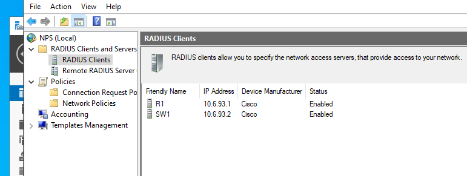
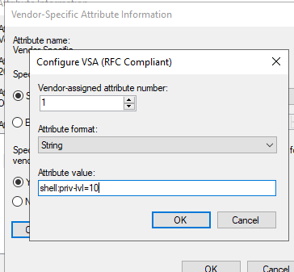
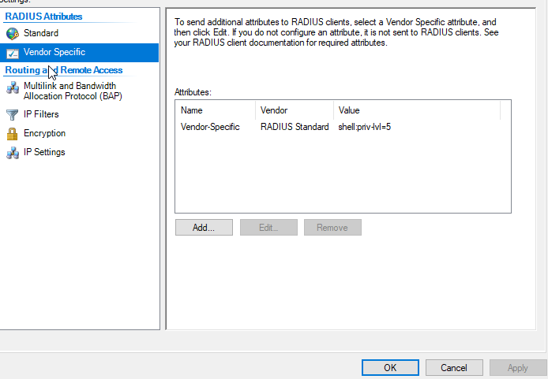
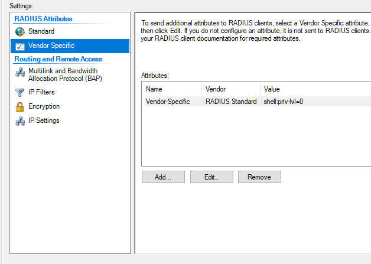
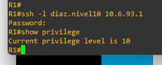
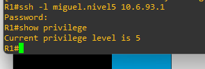
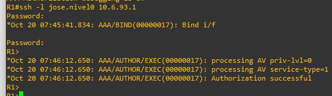
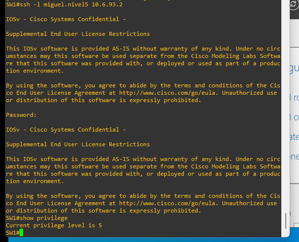
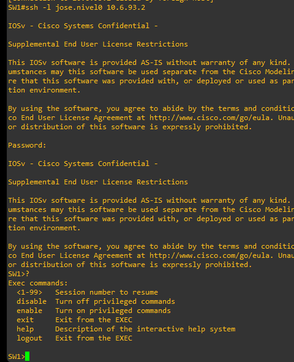
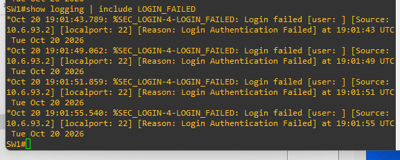

# INFORME TÉCNICO — SEMANA 6

## Implementación de AAA/RADIUS con Active Directory, NPS y equipos Cisco

**Fecha de pruebas:** 20 de octubre de 2026  
**Estado:** pruebas principales completadas; publicación GitHub y video pendientes.  
**Entorno:** GNS3, Cisco IOS 15.2, Cisco IOSv L2 y Windows Server con AD DS/NPS.

## 1. Propósito del laboratorio

Implementar autenticación, autorización y contabilidad (AAA) centralizadas mediante RADIUS para la administración SSH de un router y un switch Cisco. El servidor Windows proporciona Active Directory para las cuentas y grupos, mientras NPS aplica las políticas de acceso y asigna niveles de privilegio IOS 0, 5 y 10. Se mantiene un usuario local de respaldo y autenticación local para consola y auxiliar.

## 2. Alcance y topología real

La topología real contiene **únicamente R1 → SW1 → SRV-AD-NPS**. No se incluye PC ni Cloud porque no forman parte de la infraestructura empleada en las pruebas. Se conserva la captura original remitida por el estudiante, sin redibujarla.

| Nodo | Interfaz principal | Dirección IPv4 | Rol |
|---|---|---|---|
| R1 | FastEthernet0/0 | 10.6.93.1/24 | Router; cliente RADIUS; SSH/AAA |
| SW1 | GigabitEthernet0/0 hacia R1; SVI Vlan10 | 10.6.93.2/24 | Switch; cliente RADIUS; SSH/AAA |
| SRV-AD-NPS | NIC conectada a SW1 Gi0/1 | 10.6.93.10/24 | Active Directory, grupos y servidor NPS |

Red: `10.6.93.0/24`; R1 Fa0/0 conectado a SW1 Gi0/0; SW1 Gi0/1 al servidor. El running-config de R1 incluye una interfaz de administración adicional `192.168.200.250/24`, ajena a la topología presentada y no utilizada para las pruebas AAA/RADIUS.

## 3. Diseño de identidades y políticas NPS

| Grupo AD | Cuenta de prueba | Política de NPS | Cisco-AVPair |
|---|---|---|---|
| AAA-NIVEL-0 | jose.nivel0 | AAA-NIVEL-0 | `shell:priv-lvl=0` |
| AAA-NIVEL-5 | miguel.nivel5 | AAA-NIVEL-5 | `shell:priv-lvl=5` |
| AAA-NIVEL-10 | diaz.nivel10 | AAA-NIVEL-10-ADMIN | `shell:priv-lvl=10` |

Las tres políticas NPS habilitadas comprueban la pertenencia a grupos AD. Se utilizaron autenticación PAP y `Service-Type = Login`; la asignación del nivel se realizó mediante el atributo específico de Cisco (Vendor-Specific, Cisco-AVPair). NPS tiene definidos como clientes RADIUS a R1 (`10.6.93.1`) y SW1 (`10.6.93.2`). **PAP se documenta únicamente como decisión de laboratorio controlado, no como configuración de producción recomendada.**

## 4. Configuración de Cisco

En ambos equipos se activó `aaa new-model`; se definió `radius server NPS-SERVER` en `10.6.93.10`, UDP/1812 para autenticación y UDP/1813 para Accounting, y el grupo `RAD-GROUP`. Se creó `adminlocal` con privilegio 15 como identidad local de respaldo.

**Administración SSH/VTY:** autenticación `RAD-LOCAL` (RADIUS y método local de respaldo), autorización EXEC `RAD-EXEC`, SSH versión 2 y `transport input ssh`.

**Consola y AUX:** método local `CONSOLA-LOCAL`, autorización EXEC `CONSOLA-EXEC` y habilitación de `aaa authorization console`.

**Registros:** `login on-success log`, `login on-failure log`, `logging buffered 16384 informational`, `service timestamps log datetime msec` y `aaa accounting exec default start-stop group RAD-GROUP`.

**Endurecimiento:** R1 y SW1 guardaron la configuración; SW1 desactivó `ip http server` y `ip http secure-server`. Para las líneas completas consulte `../configs/` y los comandos comentados en `../comandos/`. Los secretos están sustituidos por marcadores; esos archivos no son restauraciones ejecutables sin adaptación.

**Precisión del enunciado:** el requisito «Solo permitir autenticación y autorización a puertos de consola y auxiliar» entra en tensión con la exigencia simultánea de SSH. En esta implementación se aplicó AAA local a consola/AUX y RADIUS a VTY/SSH; esta interpretación debe aclararse con el docente si pretende una restricción estrictamente excluyente.

## 5. Metodología de pruebas y resultados

| Prueba realizada | R1 | SW1 | Resultado |
|---|---|---|---|
| Acceso SSH mediante AD/NPS | Verificado | Verificado | Autenticación aceptada |
| Privilegio 10 | Verificado | Verificado | `show privilege` = 10 |
| Privilegios 5 y 0 | Verificados en pruebas anteriores | Verificados en pruebas anteriores | Aplicación de políticas NPS; en nivel 0 se corroboró mediante depuración AAA |
| Autenticación fallida | Log `LOGIN_FAILED` | Log `LOGIN_FAILED` | Registrada en Syslog |
| Cierre de sesión | `LOGOUT` | `LOGOUT` | Registrado |
| Accounting RADIUS | Start/Stop confirmado en NPS | Start/Stop confirmado en NPS | Paquetes tipo 4; estados 1/2 |
| Autorización EXEC | Debug temporal positivo | Debug temporal positivo | `processing AV priv-lvl=10`; `Authorization successful` |
| Consola | Acceso local probado | Acceso local probado | Funcional |
| Auxiliar | Configuración verificada | Configuración verificada | Sin prueba de conexión física |

### 5.1 Evidencia de Accounting Start/Stop

En el log NPS `IN2610`, los dos equipos enviaron paquetes RADIUS de tipo **4** (`Accounting-Request`). Los campos **Acct-Status-Type = 1** y **2** identifican respectivamente `Start` y `Stop`. Cada pareja comparte `Acct-Session-Id = 00000008` **dentro del mismo dispositivo**.

| Equipo | IP | Start | Stop | ID de sesión |
|---|---|---|---|---|
| SW1 | 10.6.93.2 | 19:04:40 | 19:05:00 | 00000008 |
| R1 | 10.6.93.1 | 19:08:41 | 19:09:01 | 00000008 |

### 5.2 Evidencia de autenticación y niveles

## 6. Seguridad y limitaciones

- Las configuraciones originales contenían hashes de cuentas y claves compartidas RADIUS. Los archivos publicados en `configs/` están sanitizados. Nunca publicar contraseñas ni claves reales.
- Las depuraciones `debug aaa authorization` se ejecutaron temporalmente y se desactivaron con `undebug all`. Confirman decisiones de autorización, **no** un registro permanente de cada comando.
- RADIUS Accounting de sesiones EXEC no sustituye la auditoría por comandos que suele obtenerse mediante TACACS+.
- AUX quedó configurado, pero no se realizó una prueba física de conexión.
- Los registros Start/Stop confirman solicitudes Accounting recibidas por NPS; no equivalen por sí solos a certificación de todas las respuestas de contabilidad.
- La interfaz de administración adicional de R1 figura en su configuración por fidelidad documental, pero no se agrega un dispositivo inexistente al diagrama.

## 7. Archivos y reproducibilidad

- [`../README.md`](../README.md): presentación del proyecto y acceso principal.
- [`../configs/`](../configs/): running-configs sanitizados de R1 y SW1.
- [`../comandos/`](../comandos/): comandos de configuración, verificación y procedimiento AD/NPS; no se inventaron scripts PowerShell.
- [`../evidencias/`](../evidencias/): capturas de resultados seleccionadas.
- [`../diagramas/topologia-aaa-radius.png`](../diagramas/topologia-aaa-radius.png): captura original de GNS3.
- [`GUIA-VIDEO.md`](GUIA-VIDEO.md): preparación del video demostrativo.

## 8. Conclusiones

Se consiguió la autenticación centralizada en Active Directory mediante NPS/RADIUS, autorización diferenciada de niveles 0, 5 y 10 y trazabilidad de accesos mediante Syslog y registros de Accounting Start/Stop para R1 y SW1. Los resultados respaldan el funcionamiento de AAA en un laboratorio controlado, con las limitaciones AUX y auditoría persistente documentadas. La publicación del repositorio y el video deben completarse por separado.

## 9. Anexo visual y secuencia completa de procedimientos

### Políticas NPS

### Atributo Cisco nivel 10

### Atributo Cisco nivel 5

### Atributo Cisco nivel 0

### R1 nivel 10

### R1 nivel 5

### R1 nivel 0

### SW1 nivel 10

### SW1 nivel 5

### SW1 nivel 0

### SW1 autenticación fallida

## 10. Configuraciones completas y procedimientos

Los dos running-configs completos sanitizados se suministran en [R1](../configs/R1-running-config-SANITIZADO.txt) y [SW1](../configs/SW1-running-config-SANITIZADO.txt). Los comandos de configuración y verificaciones están en [comandos Cisco](../comandos/01-AAA-RADIUS-SSH-CISCO.txt), [verificaciones](../comandos/02-VERIFICACIONES-CISCO.txt) y [proceso AD/NPS](../comandos/03-NPS-AD-PROCEDIMIENTO.md). No se inventaron scripts PowerShell.

## 9. Anexo visual y secuencia completa de procedimientos

### Políticas NPS

### Atributo Cisco nivel 10

### Atributo Cisco nivel 5

### Atributo Cisco nivel 0

### R1 nivel 10

### R1 nivel 5

### R1 nivel 0

### SW1 nivel 10

### SW1 nivel 5

### SW1 nivel 0

### SW1 autenticación fallida

## 10. Configuraciones completas y procedimientos

Los dos running-configs completos sanitizados se suministran en [R1](../configs/R1-running-config-SANITIZADO.txt) y [SW1](../configs/SW1-running-config-SANITIZADO.txt). Los comandos de configuración y verificaciones están en [comandos Cisco](../comandos/01-AAA-RADIUS-SSH-CISCO.txt), [verificaciones](../comandos/02-VERIFICACIONES-CISCO.txt) y [proceso AD/NPS](../comandos/03-NPS-AD-PROCEDIMIENTO.md). No se inventaron scripts PowerShell.
